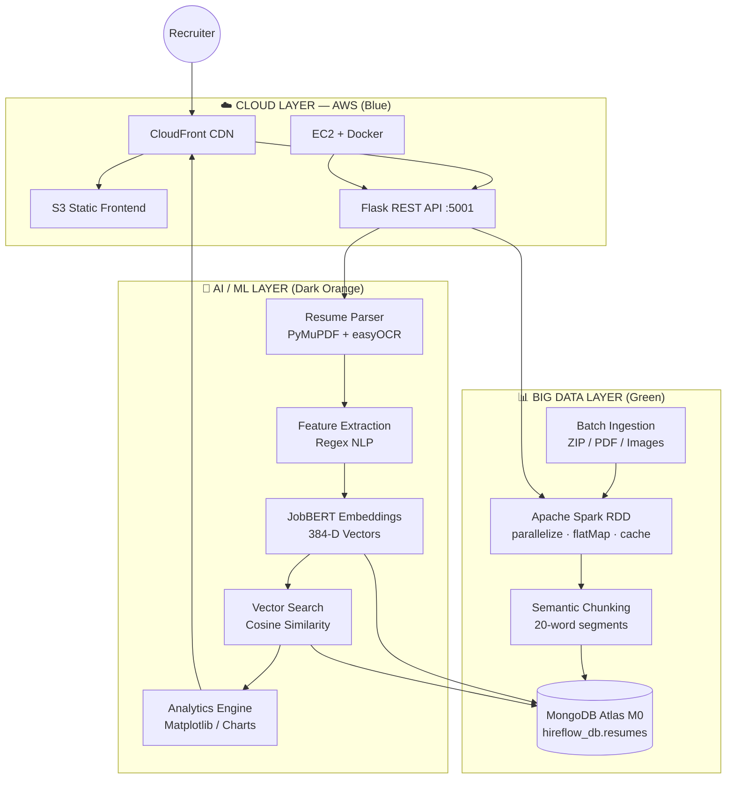
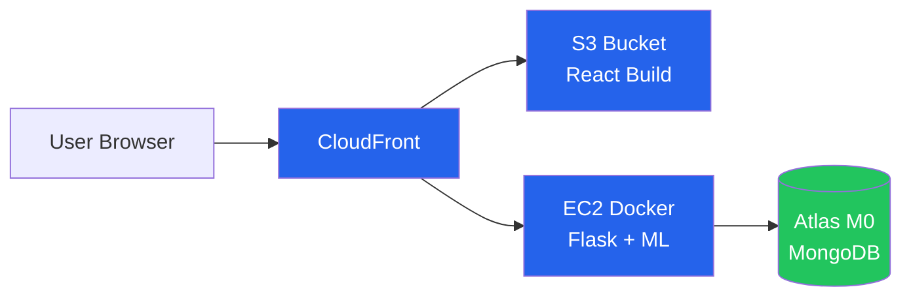

# HireFlow AI — Academic Poster Content Pack
**Format target:** 60% visuals · 20% text · 20% white space  
**Tri-course:** Big Data + AI/ML + Cloud (AWS)

---

## POSTER LAYOUT (one slide / A1 portrait)

```
┌─────────────────────────────────────────────────────────────┐
│  [LOGO]  HIREFLOW AI          [hero visual: pipeline icons] │  8%
├─────────────────────────────────────────────────────────────┤
│  §1 INTRO          │  §2 METHODOLOGY    │  [mini workflow] │  22%
├────────────────────┴──────────────────┴──────────────────┤
│           §3 TRI-COURSE ARCHITECTURE (LARGE DIAGRAM)        │  28%
├──────────────────────────────┬──────────────────────────────┤
│  §4 RESULTS                  │  [screenshots + metrics]     │  22%
├──────────────────────────────┴──────────────────────────────┤
│  §5 CONCLUSION + FUTURE          [QR → demo URL]            │  10%
└─────────────────────────────────────────────────────────────┘
```

**Color palette**
| Layer | Color | Hex |
|-------|-------|-----|
| Big Data | Green | `#22C55E` |
| AI/ML | Dark Orange | `#EA580C` |
| Cloud | Blue | `#2563EB` |
| Background | Off-white | `#F8FAFC` |
| Text | Charcoal | `#1E293B` |

---

# SECTION 1 — Introduction & Problem Definition
**Text budget: ~80 words**

### Headline (large visual text)
**HireFlow AI — Intelligent Resume Screening at Scale**

### Context / Domain (1–2 lines)
HR and recruitment teams receive **hundreds of resumes per role**. Manual screening is slow, inconsistent, and cannot scale with modern hiring volume.

### Problem Statement (bullet visual — 3 icons: clock, person, stack)
- **Volume:** 500+ resumes per job posting  
- **Latency:** Days of manual review per batch  
- **Quality:** Subjective, non-reproducible shortlisting  

### Objectives (3 icon cards)

| Objective 1 | Objective 2 | Objective 3 |
|-------------|-------------|-------------|
| **Automate ingestion & ranking** of resume batches using **Big Data pipelines** (Apache Spark) | **Match candidates to Job Descriptions** using **AI embeddings** & vector similarity | **Deploy end-to-end on cloud** (AWS S3, EC2, MongoDB Atlas) for real-world access |

**Visual for §1:** Split illustration — left: piled PDFs + clock; right: clean ranked dashboard mockup.

---

# SECTION 2 — Methodology & Prototype Implementation
**Text budget: ~100 words + diagrams**

### Tech Stack (icon grid — primary visual)

| Category | Technologies |
|----------|--------------|
| **Big Data** | Apache Spark (RDD), PySpark, MongoDB NoSQL, semantic chunking |
| **AI / ML** | Sentence-Transformers (JobBERT / MiniLM-L6-v2), cosine similarity, PyMuPDF, easyOCR, regex NLP |
| **Analytics** | Matplotlib, Seaborn, Chart.js, Recharts |
| **Backend** | Python, Flask, Gunicorn, Docker |
| **Frontend** | React 18, Vite, Axios |
| **Cloud (AWS)** | **S3 + CloudFront** · **EC2 + Docker** · **MongoDB Atlas M0** |

### Prototype Implementation Steps (numbered pipeline graphic)

```
1. User uploads JD + resumes (PDF/ZIP/images) via React UI
2. Flask API parses text (PyMuPDF / OCR)
3. Metadata extraction (regex: skills, email, experience, education)
4. Spark RDD: parallelize → flatMap → semantic chunks (20 words)
5. JobBERT: 384-D embeddings per chunk
6. MongoDB Atlas: bulk insert + vector search
7. Ranked dashboard + live analytics charts
```

### Key Algorithms / Pipelines

| Pipeline | Technique |
|----------|-----------|
| **Ingestion** | `parallelize` → `flatMap(chunk_text)` → `collect` |
| **Embedding** | `SentenceTransformer('all-MiniLM-L6-v2')` → 384-D vector |
| **Retrieval** | MongoDB `$vectorSearch` OR cosine similarity fallback |
| **Scoring** | Normalized similarity → **AI Match %** (0–100) |
| **Analytics** | MongoDB aggregation → matplotlib PNG charts |

### Workflow Pseudocode (compact code block visual)

```text
INPUT: job_description, resume_files[]
FOR each file IN resume_files:
    text ← ParsePDF_OCR(file)
    meta ← ExtractSkills_Experience(text)
    chunks ← Chunk(text, size=20)
    RDD ← Spark.parallelize(resumes).flatMap(chunk)
FOR each chunk IN RDD:
    embedding ← JobBERT.encode(chunk)
    MongoDB.insert({chunk, embedding, metadata})
jd_vec ← JobBERT.encode(job_description)
rankings ← VectorSearch(jd_vec, top_k=10)
OUTPUT: sorted candidate table + analytics
```

**Visual for §2:** Horizontal 7-step flowchart with tech logos under each step.

---

# SECTION 3 — Tri-Course Integration Architecture
**Largest visual on poster — ~30% of area**

### Mermaid diagram (export from https://mermaid.live as PNG/SVG)



### Layer callout boxes (place beside diagram)

**BIG DATA (Green)**
- Data ingestion (batch uploads, ZIP)
- Storage: MongoDB NoSQL + optional S3 objects
- Preprocessing: Spark RDD transformations, chunking

**AI / ML (Dark Orange)**
- Inference: JobBERT sentence embeddings
- Matching: JD ↔ resume vector similarity
- Analytics: score distribution, skills, funnel charts

**CLOUD (Blue)**
- **Service 1:** S3 + CloudFront — React frontend
- **Service 2:** EC2 + Docker — Flask API + ML
- **Service 3:** MongoDB Atlas M0 — cloud database

### Data flow (one-line arrow under diagram)
`Upload → Spark Chunk → Embed → Atlas Store → Vector Rank → Dashboard`

---

# SECTION 4 — Results & Validation
**Text budget: ~60 words + screenshots + charts**

### Visuals to paste (capture from your running app)

| # | Screenshot | Caption |
|---|------------|---------|
| A | Dashboard with JD + ranked table | *Candidate Rankings after batch upload* |
| B | Analytics page / charts | *Live hiring analytics from MongoDB* |
| C | Backend health JSON or Spark UI | *Pipeline validation (Spark UI :4040)* |
| D | Cloud architecture mini-diagram | *AWS 3-service deployment* |

### Performance Metrics (table visual)

| Metric | Result | Notes |
|--------|--------|-------|
| **Match relevance** | JD-to-resume cosine similarity | Top-K retrieval; fallback when vector index absent |
| **Processing latency** | ~25–35 s (1 resume, cold start) | Includes first-time model download |
| **Batch throughput** | 8 resumes / single request | Tested on dashboard |
| **API response** | `/api/health` → `mongodb: true` | Atlas + EC2 validated |
| **Resource mode** | Python fallback OR Spark local[*] | Spark UI on port 4040 when Java 17 available |
| **Storage scale** | 241+ candidate records (project dataset) | MongoDB-backed analytics |

### Sample results text (tiny)
- Successfully ranked candidates by **AI Match %** aligned with JD skills (Java, Python, HTML, CSS).  
- End-to-end path: **browser → API → Spark/Python → Atlas → dashboard**.

### Chart ideas (if you need extra visuals)
1. Bar chart: **Score distribution** (from `/api/analytics`)  
2. Funnel: **Pipeline stages** (upload → parse → embed → rank)  
3. Pie: **Tech stack contribution** (Big Data / AI / Cloud %)  

---

# SECTION 5 — Conclusion & Future Scope
**Text budget: ~70 words**

### Key Outcomes Validated ✓
- Unified **tri-course** system: Spark batch processing + deep learning matching + AWS cloud hosting  
- Recruiters upload JD + resumes and receive **instant ranked shortlists**  
- **Microservices-style** cloud split: frontend / API / database  

### Scalability & Integration Benefits
- Spark RDDs scale to larger batches (partition tuning)  
- MongoDB Atlas grows from M0 → dedicated cluster  
- CloudFront global CDN for frontend; EC2 vertically scalable  

### Future Enhancements
- Full **MongoDB Atlas Vector Search** index in production  
- **SQS + worker** EC2 for async large batches  
- **HTTPS** API via Nginx / ALB + custom domain  
- Re-enable **TabTransformer + TF-IDF** hybrid scoring layer  
- **HDFS** integration for enterprise-scale raw resume lake  

### Optimization / Expansion
- GPU inference on larger EC2 / SageMaker  
- Multi-tenant recruiter dashboards  
- Bias audit & explainable AI score breakdown  

**Visual for §5:** Three upward arrows labeled *Scale · Accuracy · Deploy*.

---

## SHORT “ELEVATOR” BLURB (for poster footer, 25 words)

*HireFlow AI automates resume screening using Apache Spark, JobBERT vector matching, and AWS cloud deployment—turning high-volume hiring data into ranked, analytics-ready decisions in seconds.*

---

## ASSETS CHECKLIST (60% visuals)

- [ ] Hero banner / logo wordmark  
- [ ] §1 problem icons (3)  
- [ ] §2 tech stack logo strip  
- [ ] §2 seven-step pipeline  
- [ ] §3 **large** tri-layer architecture (Mermaid export)  
- [ ] §3 AWS 3-box diagram (S3+CF | EC2 | Atlas)  
- [ ] §4 dashboard screenshot  
- [ ] §4 analytics screenshot  
- [ ] §4 metrics table / bar chart  
- [ ] §5 outcome icons  
- [ ] QR code → CloudFront URL or GitHub  

---

## AWS 3-SERVICE MINI DIAGRAM (for corner inset)



---

*Use Canva, PowerPoint, or Figma. Import Mermaid PNGs. Keep body text ≥18pt for print.*
